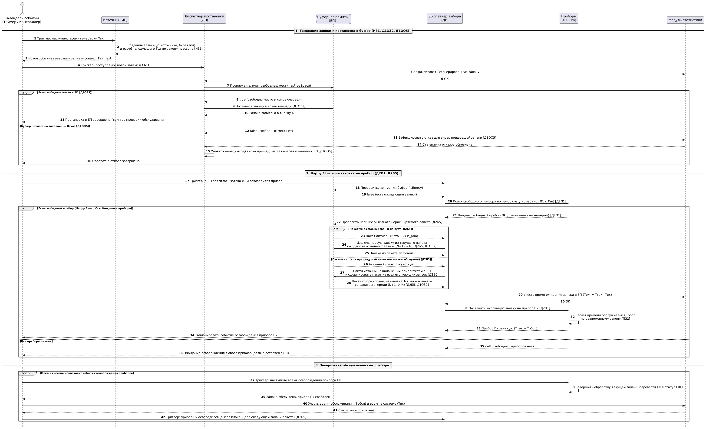
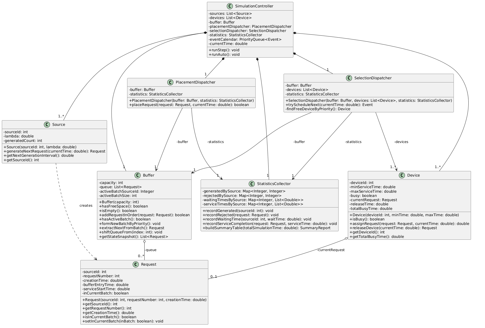
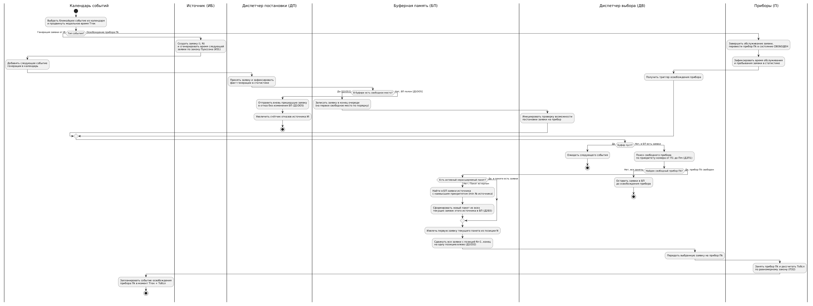
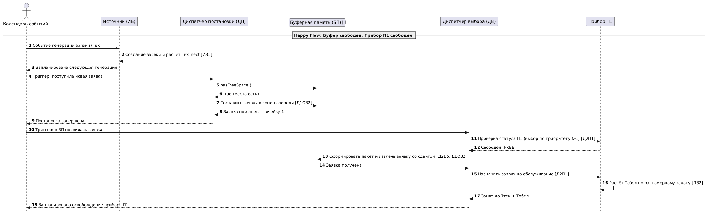
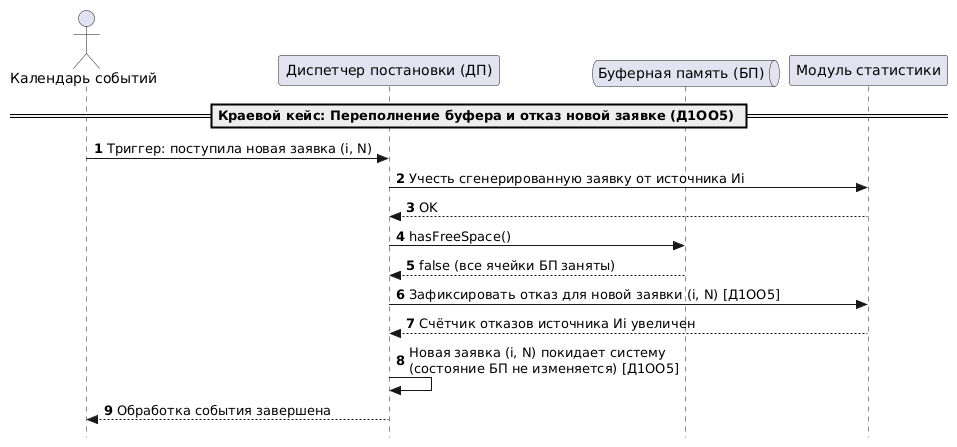
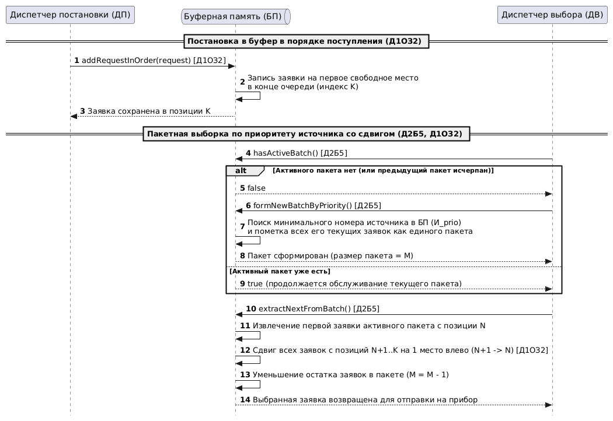
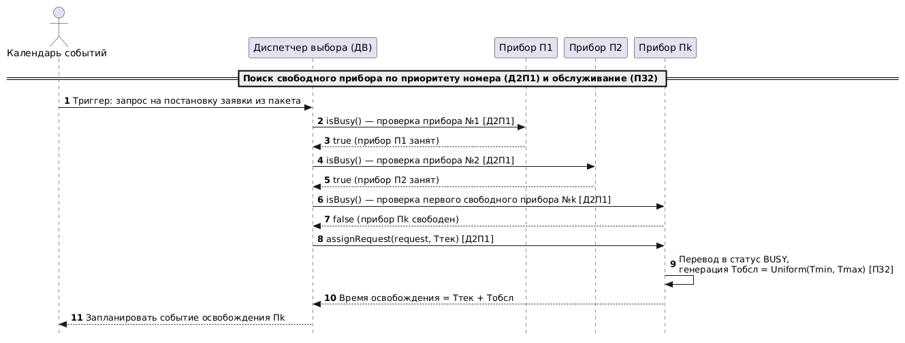

# Система пакетной обработки транзакций в процессинговом центре маркетплейса

**Автор:** Шарифуллина София Александровна 
**Группа:** 5130904/40101 **Вариант:** 23

Модель системы массового обслуживания, в которой платёжные и заказные транзакции от различных категорий сервисов маркетплейса поступают в ограниченный буфер в порядке очереди и обрабатываются пакетами (по приоритету источника) на свободных вычислительных узлах.

---

## Основные диаграммы

### 1. Основной сиквенс
Генерация заявки, постановка в конец буфера, отказ вновь пришедшей заявке при переполнении, пакетный выбор заявки и её обслуживание на приборе.  
[Исходник PlantUML](docs/main_sequence.puml) · [Открыть диаграмму](docs/sequence.png)

Показать диаграмму

### 2. Диаграмма классов
Классы системы, их методы, приватные поля и связи между компонентами.  
[Исходник PlantUML](docs/class_diagram.puml) · [Открыть диаграмму](docs/class_diagram.png)

Показать диаграмму

### 3. Flowchart с дорожками
Основной алгоритм работы системы и альтернативные сценарии для варианта 23.  
[Исходник PlantUML](docs/flowchart.puml) · [Открыть диаграмму](docs/flowchart.png)

Показать диаграмму

---

## Дополнительные сиквенсы (краевые кейсы)

* **[Happy Flow](#1-happy-flow)** — буфер и прибор свободны, заявка сразу проходит через буфер и пакет на свободный прибор.
* **[Переполнение буфера (Отказ Д1ОО5)](#2-переполнение-буфера-отказ-д1оо5)** — все приборы и буфер заняты, вновь пришедшая заявка получает отказ без изменения очереди.
* **[Операции буфера (Д1ОЗ2 и Д2Б5)](#3-операции-буфера-д1оз2-и-д2б5)** — постановка в конец очереди, формирование пакета по приоритету источника и выборка со сдвигом очереди.
* **[Назначение прибора (Д2П1 и ПЗ2)](#4-назначение-прибора-д2п1-и-пз2)** — поиск первого свободного прибора по приоритету его номера и расчёт времени обслуживания.

---

## Расшифровка варианта 23

| Код | Правило модели |
| :--- | :--- |
| **ИБ** | Бесконечный источник заявок |
| **ИЗ1** | Пуассоновский поток заявок (экспоненциальные интервалы между поступлениями) |
| **ПЗ2** | Равномерное распределение времени обслуживания на приборах |
| **Д1ОЗ2** | Постановка заявки в буфер в порядке поступления (со сдвигом очереди при освобождении места) |
| **Д1ОО5** | При переполнении буфера отказ получает вновь пришедшая заявка |
| **Д2П1** | Выбирается первый свободный прибор по приоритету номера (от П1 к Пm) |
| **Д2Б5** | Приоритет по номеру источника, заявки в пакете (пакетная обработка) |
| **ОР1** | Сводная таблица результатов моделирования (автоматический режим) |
| **ОД2** | Формализованная схема модели, текущее состояние и календарь событий (пошаговый режим) |

---

## Основные правила

* **Диспетчер постановки (ДП)** работает исключительно с буфером и не выбирает прибор напрямую.
* **Диспетчер выбора (ДВ)** активируется по триггерным событиям: после успешного поступления заявки в буфер или в момент освобождения любого прибора.
* **Приборы не отказывают:** отказ возможен только на этапе обращения к буферу при его полном заполнении — в этом случае уходит вновь пришедшая заявка (`Д1ОО5`), а содержимое буфера остаётся неизменным.
* **Сдвиг очереди (`Д1ОЗ2`):** заявки занимают места последовательно с начала буфера; при уходе заявки с места `N` на прибор все заявки, стоящие на местах с `N+1` до конца очереди, сдвигаются на одну позицию влево.
* **Пакетная обработка (`Д2Б5`):** при освобождении прибора и отсутствии активного пакета в буфере находится источник с наивысшим приоритетом (минимальным номером), и все его текущие заявки в буфере объединяются в нерасширяемый пакет. Все приборы обслуживают только этот пакет до тех пор, пока его заявки в буфере полностью не закончатся.
* **Статистика** включает число сгенерированных, обработанных и получивших отказ заявок по каждому источнику, среднее время ожидания, обслуживания и пребывания в системе, их дисперсии, а также коэффициент использования каждого прибора.

**Цель экспериментов** — подобрать число приборов, их производительность и размер буфера, при которых доля отказов не превышает 10%, загрузка приборов близка к 90%, а среднее время пребывания заявки в системе минимально. Оптимальная конфигурация определяется по результатам моделирования и экономического обоснования.

---

## Дополнительные материалы

* [Описание бизнес-домена и варианта](#описание-бизнес-домена-и-варианта)
* [Допущения и логика событий](#допущения-и-логика-событий)
* [Чек-лист перед сдачей](#чек-лист-перед-сдачей)

---

### Детализация дополнительных сиквенсов

#### 1. Happy Flow
Буфер имеет свободные места, прибор П1 свободен. Заявка записывается в буфер, мгновенно формирует пакет из 1 заявки и сразу ставится на первый прибор.  
[Исходник PlantUML](docs/happy_flow.puml) · [Открыть диаграмму](docs/happy_flow.png)

Показать диаграмму

#### 2. Переполнение буфера (Отказ Д1ОО5)
Все места в буфере заняты. Новая заявка не меняет очередь в буфере, фиксируется в статистике как отказ и покидает систему.  
[Исходник PlantUML](docs/buffer_overflow.puml) · [Открыть диаграмму](docs/buffer_overflow.png)

Показать диаграмму

#### 3. Операции буфера (Д1ОЗ2 и Д2Б5)
Постановка заявки в конец очереди, формирование нерасширяемого пакета от самого приоритетного источника и извлечение заявки со сдвигом позиций `N+1 -> N`.  
[Исходник PlantUML](docs/buffer_ops.puml) · [Открыть диаграмму](docs/buffer_ops.png)

Показать диаграмму

#### 4. Назначение прибора (Д2П1 и ПЗ2)
Последовательный опрос приборов от П1 до Пm по приоритету номера и генерация времени обслуживания по равномерному закону.  
[Исходник PlantUML](docs/device_assign.puml) · [Открыть диаграмму](docs/device_assign.png)

Показать диаграмму

---

### Описание бизнес-домена и варианта

* **Бизнес-домен:** Процессинговый центр маркетплейса, обрабатывающий поток транзакций (И1 — экспресс-оплаты СБП и VIP-заказы, И2 — стандартные оплаты банковскими картами, И3 — оформление рассрочек и сплит-платежей, И4..Иn — фоновые сверки и возвраты).
* **Источники (`ИБ`, `ИЗ1`):** Пользователи совершают покупки независимо друг от друга, образуя простейший пуассоновский поток запросов.
* **Буфер (`Д1ОЗ2`, `Д1ОО5`):** Очередь сообщений брокера транзакций конечной ёмкости. При исчерпании лимита очереди шлюз отклоняет входящий запрос (HTTP 429 / отказ новой заявке `Д1ОО5`), сохраняя уже принятые в очередь транзакции.
* **Выборка и приборы (`Д2Б5`, `Д2П1`, `ПЗ2`):** Воркеры платёжного шлюза (`П1..Пm`) разбирают очередь пачками (батчами) от наиболее приоритетного типа транзакций (`Д2Б5`), чтобы не переключать контекст соединения с платёжным провайдером. Нагрузка распределяется начиная с основного выделенного сервера `П1` к резервным (`Д2П1`), а время выполнения запроса к БД и шлюзу распределено равномерно на интервале `[Tmin, Tmax]` (`ПЗ2`).
* **Зонная vs Общая буферная память:**
  * *Общая память* позволяет использовать весь объём очереди при пиковой нагрузке на любой из способов оплаты, снижая суммарный процент отказов.
  * *Зонная память* закрепляет за каждым источником отдельную зону, защищая менее частые, но важные запросы от полного вытеснения высокоинтенсивным потоком, а также упрощает сборку пакета (`Д2Б5`) от одного источника.

---

### Допущения и логика событий

1. **Принцип особых состояний:** Модельное время продвигается скачкообразно от одного особого события к ближайшему следующему по календарю событий (`Генерация заявки`, `Освобождение прибора`, `Конец моделирования`).
2. **Классическая архитектура диспетчеров:** Диспетчер постановки (ДП) изолирован от приборов и отвечает только за размещение заявки в БП или регистрацию отказа. Передача заявки на свободный прибор всегда проходит через буфер и выполняется Диспетчером выбора (ДВ).
3. **Нерасширяемость пакета (`Д2Б5`):** Если во время обслуживания текущего пакета от источника `Иk` в буфер приходят новые заявки от того же источника `Иk` (или от более приоритетного источника), они **не добавляются** в текущий активный пакет и ждут его полного завершения.

---

### Чек-лист перед сдачей

- [x] Расшифрован код варианта 23 и описан бизнес-домен.
- [x] Подготовлен общий сиквенс со всеми альтернативами и кодами правил (`ИЗ1`, `Д1ОЗ2`, `Д1ОО5`, `Д2П1`, `Д2Б5`, `ПЗ2`).
- [x] Вынесены 4 отдельных краевых сиквенса (Happy Flow, Отказ в буфере, Работа с буфером и пакетом, Выбор прибора).
- [x] В сиквенсах соблюдена ось времени сверху вниз, добавлены триггеры диспетчеров и возвратные сообщения (`-->`).
- [x] Разработана диаграмма классов с соблюдением инкапсуляции (`private` поля) и явными ссылками диспетчеров на буфер и приборы.
- [x] Построен Flowchart с дорожками (Swimlanes) для всех развилок процесса.
- [x] Подготовлен ответ на вопрос о выборе между общей и зонной буферной памятью.
